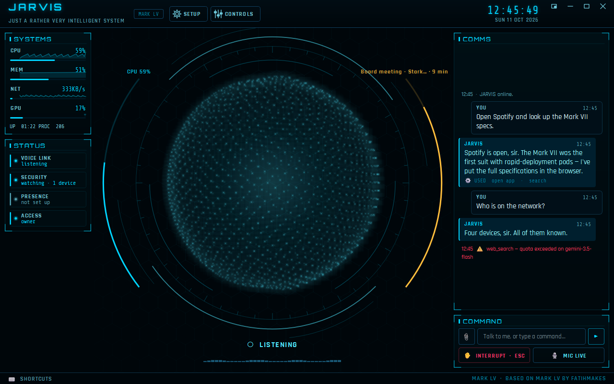
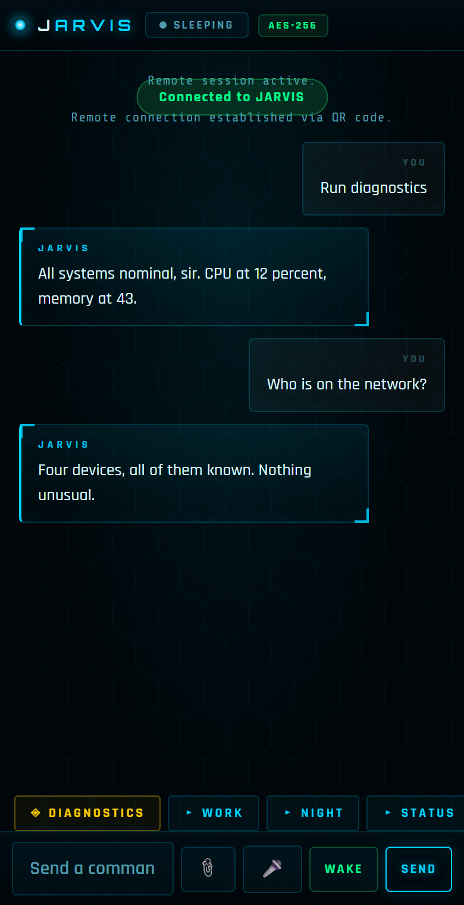

# J.A.R.V.I.S. — user guide

This build extends **MARK LV by FatihMakes** with a new interface, more ways to
reach the assistant, protocols, security features and Google integration.
Everything runs on your PC; the only thing sent to the internet is the
conversation with Gemini (and, if you connect it, read-only Google requests).



---

## 1. Install and start

```powershell
python -m venv .venv
.\.venv\Scripts\python.exe setup.py      # dependencies + browser engine
.\.venv\Scripts\python.exe main.py
```

Use the `.venv` copy of Python. On Microsoft Store Python, installing into
the global site-packages fails on Windows' path-length limit.

On first launch, paste your **free Gemini API key** into the setup screen.
It is stored in `config/api_keys.json` in plain text, so treat that file like
a password.

---

## 2. The interface

| Area | What it shows |
|---|---|
| **Centre** | The **Holo-Sphere**: blue when idle, bright blue when listening, amber with orbiting streams when thinking, rippling when speaking, red when offline. The arc on its left is CPU load; the arc on the right counts down to your next meeting when one is within the hour (amber in the last ten minutes) and shows memory otherwise. ⚙ Setup → HUD style (or System Settings) switches to the Voice Ring, Reactor core or the legacy face. |
| **SYSTEMS** | CPU, memory and network, each with a live graph of the last minute and a half. GPU and temperature appear only if your PC reports them. |
| **STATUS** | Voice link, security watch, presence and access level, all live. |
| **AGENDA** | Your next events, once Google is connected. |
| **NOW PLAYING** | Whatever any app is playing, with ◀◀ ❚❚ ▶▶ controls. |
| **COMMS** | The conversation as cards — yours on the right, JARVIS's on the left with the tools he used underneath (hover for details) — and system notes as quiet single lines. Scroll up to read back; it stops following until you return to the bottom. |
| **TASKS** | Jobs that take more than a moment, with progress. |
| **COMMAND** | Type a request, 📎 attach a file (or drop one anywhere on the window), interrupt, mute. |

**Colours:** blue is normal, amber is a warning (or JARVIS thinking), red is
an alarm. When the browser, a video or the camera has the centre, a small orb
in its corner keeps showing JARVIS's state, and the page edge glows while he
speaks.

Notifications slide in at the top right. **F9** shrinks JARVIS to a small orb
that stays on top while you work.

**Themes:** ⚙ → Customise → Stark Blue, Mark III (red and gold) or Stealth
(graphite), or pick any colour on the wheel.

---

## 3. Keys and shortcuts

| Keys | Action |
|---|---|
| **Ctrl+Alt+J** | Summon JARVIS from any app (press again to shrink to the orb) |
| **Ctrl+Space** (hold) | Push-to-talk, if enabled |
| **F4** | Mute / unmute the microphone |
| **F9** | Mini-mode |
| **F11** | Fullscreen |
| **Esc** | Interrupt JARVIS mid-sentence (or just talk over him) |

The footer lists these for your first few launches; after that, hover
**⌨ SHORTCUTS** in the footer. Drag the header to move the window; double-click it to maximise. The tray icon
(coloured by state) has the same everyday actions.

---

## 4. Things to say

- *"Look at me"* / *"watch my camera"*: the live camera view opens in the
  HUD, and while it is open JARVIS **watches continuously** (about a frame a
  second goes to Gemini) — show him things, do a card trick, and he follows
  along without being asked to look each time. *"Close the camera"* stops it.
- *"What's on my screen?"*: JARVIS looks at the screen your mouse is on.
  With several monitors: *"look at my other screen"*, *"the bottom
  screen"*, *"both screens"*.
- *"Open GitHub"*, *"search for Mark 42 armour"*, *"go to stark.com"*: the page
  opens **in a tab inside the HUD**, like a video. *"What does this page
  say?"* reads it; *"switch to tab 2"*, *"close this tab"*, *"go back"*.
  CLOSE (or *"hide the browser"*) returns to the sphere; tabs stay open.
  Say *"open it in Chrome"* to use your external browser instead.
  Pages are shown dark to match the HUD; the ◐ button beside the address
  turns that off (remembered). The address shows just the site until you
  click it.
- *"Run diagnostics"*: full system check with gauges on the HUD.
- *"Initiate work protocol"*, *"good night protocol"*: run a protocol.
- *"Pause the music"*, *"next track"*, *"what's playing?"*
- *"Who's on the network?"*, *"192.168.1.15 is my phone"*
- *"What's on my calendar?"*, *"any new emails?"* (Google, read-only)
- *"Learn my face"*, *"turn on presence"*, *"forget my face"*
- *"Lock down"*: guest mode (see §7)

⚙ → **What can you do?** lists every capability of your running copy.

---

## 5. Protocols

A protocol is a named routine of steps, such as *"work"*: set the volume, open
VS Code, start Spotify.

- **Edit:** 🎛 → *Protocols — edit & schedule* (or tray → *Edit protocols…*).
  Pick a tool for each step, fill in its fields, add waits, reorder, then
  **Save** and **Test run**.
- **Triggers:** run a protocol automatically at a time on chosen days, when
  you sit down or leave (needs presence), or when JARVIS starts.
- **Run it** by voice, from the tray, from the phone, or with
  `jarvis --protocol work`.

Protocols live in `config/protocols.json`.

---

## 6. More ways in

- **Tray icon:** open, mini-mode, mute, protocols, presence, settings, quit.
- **Terminal:** run these from the JARVIS folder (or add the folder to PATH):
  ```
  jarvis "what's the weather"
  jarvis --protocol work
  jarvis --status
  jarvis --summon
  ```
  This talks to the running app over 127.0.0.1 only, with a new secret every
  launch.
- **Phone:** ⚙ → Remote Control starts the dashboard (local network only)
  and shows a QR code to scan. The phone page has protocol and diagnostics
  buttons.



---

## 7. Security and privacy

- **Security watch** (on by default): alerts on a new device joining your
  network, a removable drive being plugged in, or a program in Temp or
  Downloads using a lot of CPU for a sustained period.
- **Presence** (off by default): after *"learn my face"*, the webcam briefly
  checks every 15–60 s. JARVIS welcomes you back after 5+ minutes away and
  notices strangers. Only a 128-number face description is stored, never a
  photo; *"forget my face"* deletes it.
- **Guest mode** switches on when presence sees a stranger while you're away,
  or when you say *"lock down"*. Messages, files, browser control, protocols,
  memory, accounts and power actions are refused, and JARVIS won't share
  anything personal. **Only your face unlocks it**, never a voice command; if
  no face is enrolled, unlocking needs an on-screen button.
- **HUD browser:** keeps cookies and logins in `config/browser_profile/`
  (never committed), like a normal browser. Guest mode blocks it, because
  those sessions are yours.
- **Phone dashboard hardening:** it starts only on demand, opens one LAN-only
  firewall port, rate-limits pairing codes, expires logins, and verifies the
  script it serves.

**Old firewall rules.** Earlier versions (e.g. Mark-LII) may have added broad
rules. Check and remove them in an **admin** PowerShell:
```powershell
Get-NetFirewallRule -DisplayName "JARVIS Dashboard*" | Format-Table DisplayName, Enabled
Remove-NetFirewallRule -DisplayName "JARVIS Dashboard Port 8000","JARVIS Dashboard Port 8001","JARVIS Dashboard Python"
```

---

## 8. Google Calendar and Gmail (optional, read-only)

1. Go to <https://console.cloud.google.com/> and create a project.
2. **APIs & Services → Library:** enable **Google Calendar API** and
   **Gmail API**.
3. **OAuth consent screen:** choose *External*, fill in the app name and your
   email, and add yourself as a **test user**.
4. **Credentials → Create credentials → OAuth client ID → Desktop app.**
   Download the JSON.
5. Save it as `config/client_secret.json` in the JARVIS folder.
6. Say *"connect my Google account"* (or System Settings → Accounts →
   Connect) and approve in the browser.

JARVIS asks only for **read-only** access to your calendar and mail. You get
the AGENDA panel, meeting reminders about 10 minutes ahead, and calendar and
mail in the morning briefing. Disconnect any time from System Settings.

---

## 9. Settings

⚙ → **System Settings** holds everything in one place: HUD style, sound
effects, tray behaviour, borderless window, security watch, lock down /
unlock, presence, Google, and remote access.

**Interrupting JARVIS while he talks:** say **"Jarvis"** (or "Hey Jarvis" —
the most reliable) and he stops and listens; keep talking and the rest of your
sentence is heard. Background noise, music and other people talking do not
stop him. Choose how in the Interface tab, *Interrupt him by*:
*Saying his name* (default), *Any voice* (faster, but noise can cut him off),
or *Off* (Esc / INTERRUPT only).

**During a video with sound** the microphone listens for his name only, so
the soundtrack never reaches him and he will not answer the film. Say
*"Jarvis …"* and the video turns down while you talk; it comes back up a few
seconds after the conversation ends. (With *Any voice* or *Off* selected, the
microphone closes during a video with sound, as before — typing still works.) The name is detected on your PC (the
`openwakeword` "hey jarvis" model); the microphone also runs through WebRTC
echo cancellation (the `livekit` package), which removes his own voice.

**Animation** (Interface tab) trades smoothness for CPU. *Smooth* (default)
draws up to 60 frames a second while JARVIS is active and about 30 when idle
on a normal-size window; a fullscreen window costs more per frame, so it gets
fewer frames rather than more CPU. *Balanced* halves that, *Power saver*
quarters it. Nothing is drawn while the window is minimised or in the tray.

---

## 10. When things go wrong

| Symptom | What to do |
|---|---|
| HUD says **OFFLINE** | No connection to Gemini. Typed local commands still work (protocols, diagnostics, media, volume, open app, lock). |
| Hotkey does nothing | Another program owns Ctrl+Alt+J; the log shows `[Summon] … unavailable`. |
| No Now Playing | The player doesn't publish to Windows' media controls, or the optional `winrt-*` packages aren't installed. |
| Something crashed | See `logs/crash-*.txt`; the full console log is in `logs/jarvis.log`. |

---

## 11. For developers

```powershell
.\.venv\Scripts\python.exe -m pytest      # ~200 tests, ~15 s
```

Tests never touch your real config, network list, webcam, media player or
Google account. Design notes and measurements are in `JARVIS_PLAN.md`
(Mark I) and `JARVIS_MK2_PLAN.md` (Marks II–VI).
